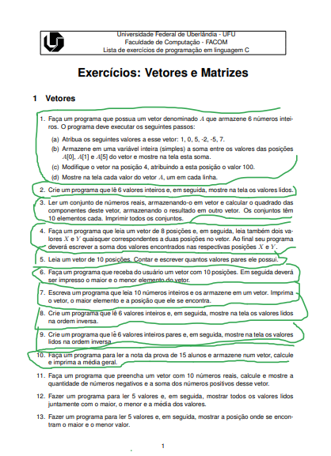
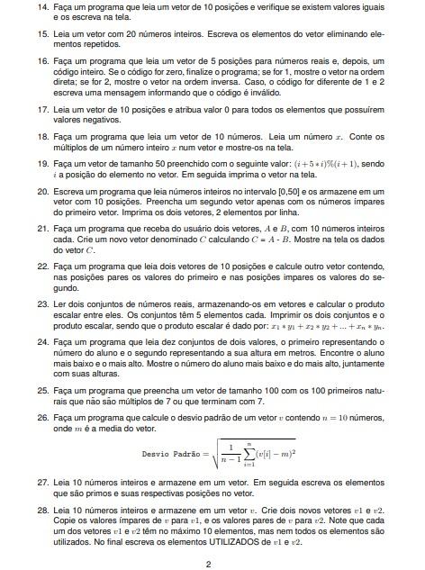
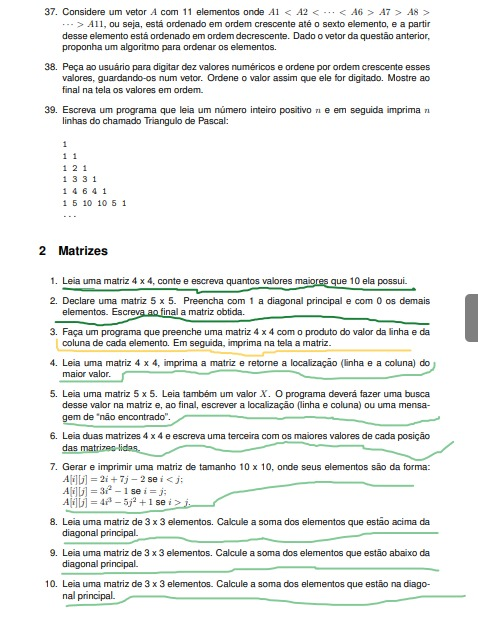
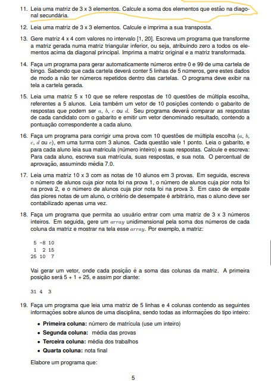
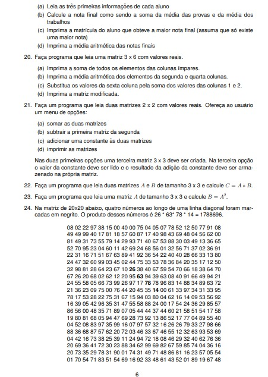
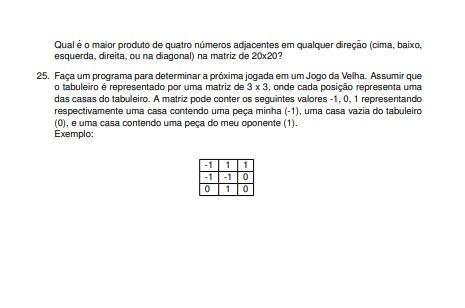

# 📚 Lista de Exercícios de Arrays em Java

Repositório com as minhas resoluções de uma lista de exercícios sobre **arrays em Java**, criada para praticar **lógica de programação**.

Cada questão da lista (em imagem, extraída do PDF) está documentada aqui, junto com o nível de dificuldade que senti ao resolvê-la.

---

## 🎯 Objetivo

- Praticar lógica de programação com vetores (arrays) em Java
- Treinar laços de repetição, condicionais e manipulação de índices
- Registrar minha evolução e identificar os pontos que ainda preciso reforçar

---

## 🚦 Legenda de Dificuldade

| Cor | Significado |
|:---:|-------------|
| 🟢 **Verde** | Tive facilidade |
| 🟡 **Amarelo** | Dificuldade média |
| 🔴 **Vermelho** | Muito difícil |

---

## 🧠 Conceitos Praticados

- **Vetores:** declaração, leitura, impressão, soma, média, maior/menor valor e posição
- **Filtros e contagens:** pares, ímpares, negativos, múltiplos e primos
- **Operações entre vetores:** soma, produto, união, intersecção e diferença
- **Manipulação:** inversão, remoção de repetidos, compactação e ordenação
- **Matrizes:** laços aninhados, diagonais, transposta e matriz triangular
- **Operações com matrizes:** soma, subtração, multiplicação e busca de valores
- **Lógica geral:** estruturas condicionais e de repetição, contadores, acumuladores e menus

---

## 📋 Questões

